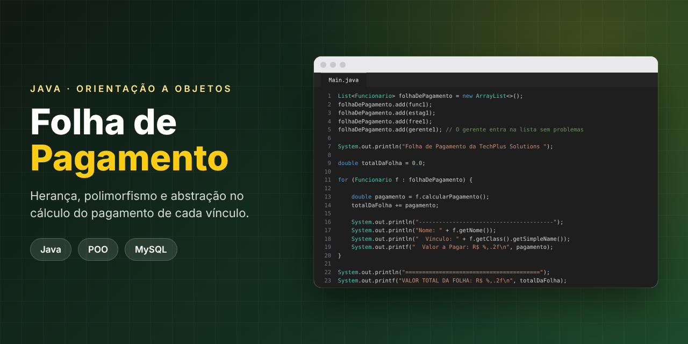
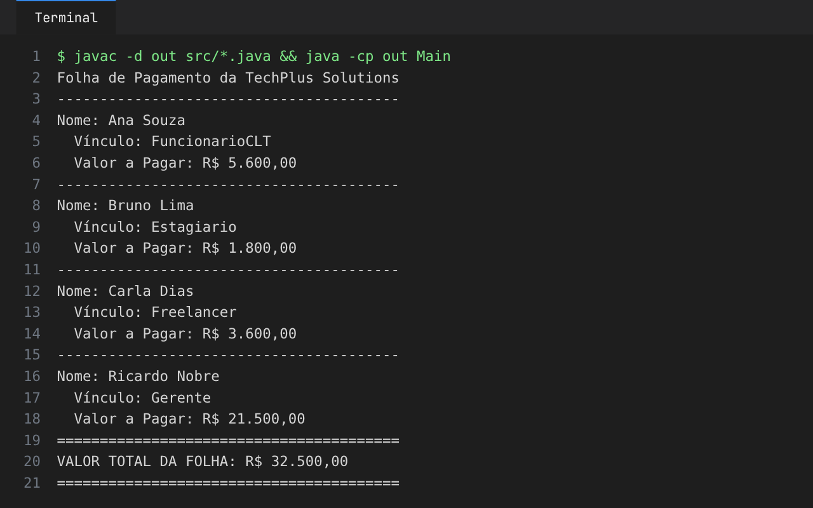

<p align="center">
  
</p>

<h1 align="center">💰 Sistema de Folha de Pagamento em Java</h1>

<p align="center">
  Simulação de folha de pagamento focada na prática de <b>Programação Orientada a Objetos</b>:
  <b>herança</b>, <b>polimorfismo</b> e <b>abstração</b> no cálculo do pagamento de cada tipo de contrato.
</p>

<p align="center">
  
  
  
  
</p>

<p align="center">
  <a href="#-sobre-o-projeto">Sobre</a> •
  <a href="#-funcionalidades">Funcionalidades</a> •
  <a href="#-telas">Saída</a> •
  <a href="#-como-executar">Como executar</a> •
  <a href="#-conceitos-de-poo">POO</a> •
  <a href="#-scripts-sql">Scripts SQL</a> •
  <a href="#-estrutura-do-projeto">Estrutura</a>
</p>

---

## 📌 Sobre o projeto

Projeto desenvolvido para reforçar conceitos de orientação a objetos, criando uma estrutura de funcionários com
diferentes tipos de contrato (CLT, Estágio, Freelancer e Gerência) e mostrando como uma única classe abstrata
simplifica o cálculo do pagamento de toda a empresa (a fictícia **TechPlus Solutions**).

## ✨ Funcionalidades

O sistema calcula o pagamento mensal de cada categoria de colaborador:

| | Vínculo | Como o pagamento é calculado |
|---|---|---|
| 👔 | **Funcionário CLT** | Salário fixo + benefícios |
| 🧑‍💼 | **Gerente** | Herda de CLT: salário fixo + benefícios + bônus de liderança |
| 🎓 | **Estagiário** | Valor fixo da bolsa-auxílio |
| 💻 | **Freelancer** | Valor da hora × horas lançadas no mês (as horas são zeradas depois do pagamento) |
| 🧾 | **Folha consolidada** | Lista cada colaborador com o vínculo e o valor, e soma o total da folha em R$ |

## 🖼️ Telas

Saída real do programa no terminal:

<p align="center">
  
</p>

## 🚀 Como executar

**Pré-requisito:** um JDK instalado (testado com o JDK 21). Não há dependências externas.

```bash
git clone https://github.com/kauaxp77/Folha-De-Pagamento.git
cd Folha-De-Pagamento
javac -d out src/*.java
java -cp out Main
```

> No Windows (PowerShell/CMD), se os acentos aparecerem errados no terminal, compile com `-encoding UTF-8`
> e rode com `java -Dstdout.encoding=UTF-8 -cp out Main` (Java 18+).

Em uma IDE (IntelliJ, Eclipse ou VS Code), basta abrir a pasta, marcar `src` como pasta de código-fonte e rodar a
classe `Main`.

O arquivo `src/Caixa.java` é um exercício à parte (cálculo do volume de uma caixa), com o seu próprio `main`:
`java -cp out Caixa`.

## 🧠 Conceitos de POO

- **Abstração:** a classe base `Funcionario` é abstrata e generaliza o que todo colaborador tem (nome, CPF e o
  método `calcularPagamento()`).
- **Herança:** `FuncionarioCLT`, `Estagiario` e `Freelancer` herdam de `Funcionario`, e `Gerente` herda de
  `FuncionarioCLT`, reaproveitando o cálculo do pai com `super.calcularPagamento()`.
- **Polimorfismo:** em `Main.java`, uma única lista `List<Funcionario>` guarda todos os colaboradores. Ao chamar
  `calcularPagamento()` dentro do laço, a JVM decide em tempo de execução qual cálculo usar para cada objeto, sem
  precisar de `if`/`switch` para cada tipo.
- **Estruturas de dados:** `ArrayList` para agrupar a folha de pagamento.

## 🗄️ Scripts SQL

A pasta [`sql/`](sql) tem dois scripts MySQL de um exercício de banco de dados à parte: o banco `gestao_estoque`
(usuários, almoxarifados, categorias, produtos, lotes e verificações de estoque de materiais odontológicos). Eles
**não são usados pelo código Java** desta pasta.

| Arquivo | Conteúdo |
|---|---|
| [`sql/dataBase.sql`](sql/dataBase.sql) | Versão corrigida: cria o banco e as tabelas com PKs e FKs, insere os registros e traz 3 relatórios, 3 indicadores, 3 `UPDATE`s e 3 `DELETE`s |
| [`sql/SCRIPTS.sql`](sql/SCRIPTS.sql) | Primeira versão: tabelas, depois PKs e FKs com `ALTER TABLE`, inserts e consultas |

```bash
mysql -u root -p < sql/dataBase.sql
```

O `dataBase.sql` foi executado sem erros num MySQL 8. O `SCRIPTS.sql` não tem o comando `USE gestao_estoque`, então
selecione o banco logo depois do `CREATE DATABASE` para rodá-lo.

## 📁 Estrutura do projeto

```
Folha-De-Pagamento/
├── src/
│   ├── Main.java            # Monta a folha (lista polimórfica) e imprime os pagamentos e o total
│   ├── Funcionario.java     # Classe abstrata base
│   ├── FuncionarioCLT.java  # Salário fixo + benefícios
│   ├── Gerente.java         # Estende FuncionarioCLT com bônus de liderança
│   ├── Estagiario.java      # Bolsa-auxílio
│   ├── Freelancer.java      # Pagamento por hora, com lancarHoras()
│   └── Caixa.java           # Exercício à parte: volume de uma caixa
├── sql/
│   ├── dataBase.sql         # Banco gestao_estoque (versão corrigida)
│   └── SCRIPTS.sql          # Banco gestao_estoque (primeira versão)
└── docs/
    ├── banner.png
    └── screenshots/
```

## 🛠️ Tecnologias

- **Java** (sem bibliotecas externas)
- **MySQL** (scripts SQL do exercício de banco de dados)

## 👨‍💻 Autor

Desenvolvido por **[kauaxp77](https://github.com/kauaxp77)**

<p align="center">⭐ Se curtiu o projeto, deixe uma estrela!</p>
